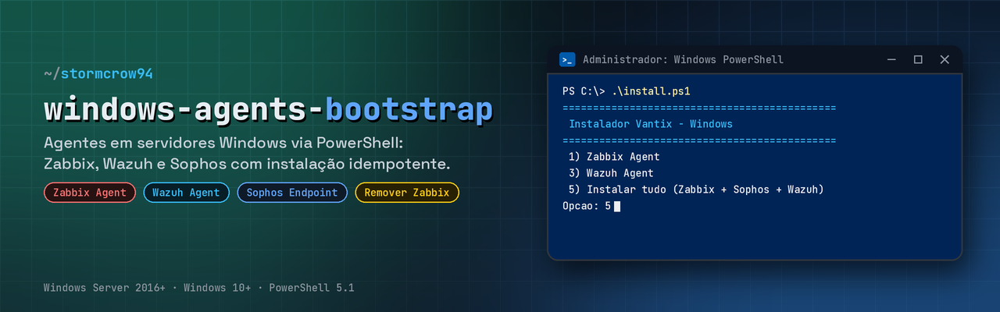

<p align="center">
  
</p>

# Instalador Vantix - Windows

Instalacao silenciosa e idempotente dos agentes usados nos servidores Windows:
**Zabbix Agent**, **Sophos Endpoint** e **Wazuh Agent**.

Substitui os scripts antigos (`main_installer.ps1`, `install_zabbix_silent.ps1`,
`install_sophos.ps1`, `install_wazuh.ps1`, `remove_zabbix.ps1`), que fixavam
versoes vencidas e nao validavam o resultado real da instalacao.

## Requisitos

- Windows Server 2016+ / Windows 10+ com **Windows PowerShell 5.1**
- Execucao como **Administrador**
- Acesso HTTPS a `cdn.zabbix.com`, `packages.wazuh.com` e ao CDN da Sophos
- Acesso TCP ao proxy Zabbix (`10.130.3.201:10051`) e ao manager Wazuh
  (`wazuh.vantix.com.br:1514` e `:1515`)

## Uso

Menu interativo:

```powershell
.\install.ps1
```

Execucao direta:

```powershell
.\install.ps1 -Zabbix
.\install.ps1 -Sophos
.\install.ps1 -Wazuh
.\install.ps1 -All
.\install.ps1 -RemoveZabbix
```

Reinstalar mesmo que a versao ja esteja presente:

```powershell
.\install.ps1 -All -Force
```

O `install.ps1` chama os scripts em `scripts\` e devolve exit code `0` apenas
quando todas as etapas passam.

## Configuracao

Tudo fica em `config\settings.psd1`. Edite o arquivo, nao os scripts.

| Chave | Padrao | Descricao |
|---|---|---|
| `Zabbix.Branch` | `7.0` | Branch do servidor Zabbix |
| `Zabbix.AgentVersion` | `latest` | Ultimo patch do branch no CDN, ou versao fixa |
| `Zabbix.StaticUrl` | vazio | Override total da URL do MSI |
| `Zabbix.Server` / `ServerActive` | `10.130.3.201` | Proxy/servidor e porta 10051 |
| `Zabbix.PreserveExistingServer` | `$true` | Mantem Server da instalacao atual |
| `Wazuh.Version` | `4.14.8` | Versao do MSI (igual ou menor que o manager) |
| `Wazuh.Manager` | `wazuh.vantix.com.br` | Endereco do manager (1514) |
| `Wazuh.RegistrationServer` | `wazuh.vantix.com.br` | authd (1515) |
| `Wazuh.AgentGroup` | `COMMCENTER` | Grupo aplicado no registro |
| `Sophos.InstallerUrl` | link do Central | Contem o token do tenant |

## O que cada script faz

### Zabbix (`scripts\Install-Zabbix.ps1`)

1. Le a configuracao existente e **preserva `Server`/`ServerActive`**.
2. Resolve o ultimo patch do branch no CDN (`zabbix_agent-<versao>-windows-amd64-openssl.msi`).
3. Detecta instalacao fora do MSI (ex.: `C:\Zabbix\zabbix_agentd.exe`), faz
   backup da config em `C:\ProgramData\Vantix\backup` e remove o servico antigo.
4. Instala/atualiza via `msiexec /qn`.
5. Reaplica as diretivas no `zabbix_agentd.conf`, reinicia o servico e valida:
   servico `Running`, porta `10050` ouvindo e log com `Starting Zabbix Agent`.

### Wazuh (`scripts\Install-Wazuh.ps1`)

1. Faz backup de `client.keys` e `ossec.conf` antes de reinstalar.
2. Instala via MSI com `WAZUH_MANAGER`, `WAZUH_REGISTRATION_SERVER`,
   `WAZUH_AGENT_GROUP` e `WAZUH_PROTOCOL`.
3. Usa o servico **`WazuhSvc`** (o script antigo tentava `net start Wazuh`,
   que nunca existe: `Wazuh` e apenas o DisplayName).
4. Restaura `client.keys` se o MSI remover a identidade do agente.
5. Valida servico ativo, chave registrada e conexao com o manager no `ossec.log`.

### Sophos (`scripts\Install-Sophos.ps1`)

1. Baixa o `SophosSetup.exe` da URL do Central (token do tenant embutido).
2. Valida a assinatura digital antes de executar.
3. Instala com `--quiet` e trata exit `3010` (reinicio pendente).
4. Aguarda os servicos `Sophos MCS Agent` e `Sophos File Scanner Service`.

O `SophosSetup.exe` e um bootstrapper: ele baixa o produto do CDN da Sophos
durante a instalacao, portanto o host precisa de internet.

### Remocao (`scripts\Remove-Zabbix.ps1`)

Desinstala pelo `ProductCode` do MSI, remove servicos remanescentes e faz backup
da configuracao. Use `-RemoveFiles` para apagar tambem os diretorios.

## Logs e backups

- Logs: `C:\ProgramData\Vantix\install-logs`
- Cache de instaladores: `C:\ProgramData\Vantix\cache`
- Backups: `C:\ProgramData\Vantix\backup`
- Logs do MSI: `zabbix_msi_*.log`, `wazuh_msi_*.log`, `zabbix_uninstall_*.log`

## Solucao de problemas

**Wazuh nao inicia** - o servico se chama `WazuhSvc`. Confira
`Get-Service WazuhSvc` e o final de
`C:\Program Files (x86)\ossec-agent\ossec.log`. Se nao houver chave em
`client.keys`, valide a conectividade com `wazuh.vantix.com.br:1515`.

**Zabbix sem coleta** - o servico pode estar ativo e o host nao existir no
servidor. Verifique `ServerActive`, a porta `10050` e o cadastro do host.

**Sophos nao instala** - confirme que a URL do Central nao expirou (o link e
gerado no console) e que o host alcanca o CDN da Sophos.

**Servico marcado para exclusao** - apos remover um servico legado, o nome so
fica livre quando todos os handles fecham. Se o MSI falhar com esse erro,
reinicie o host e execute novamente.

## Estrutura

```
install.ps1                  ponto de entrada (menu e flags)
main_installer.ps1           compatibilidade com o nome antigo
config\settings.psd1         configuracao central
lib\Common.ps1               funcoes compartilhadas
scripts\Install-Zabbix.ps1
scripts\Install-Sophos.ps1
scripts\Install-Wazuh.ps1
scripts\Remove-Zabbix.ps1
assets\                      banner e social preview
```
